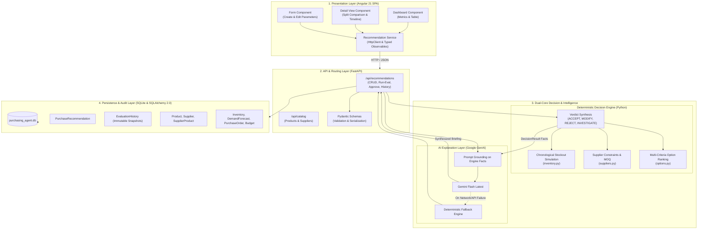
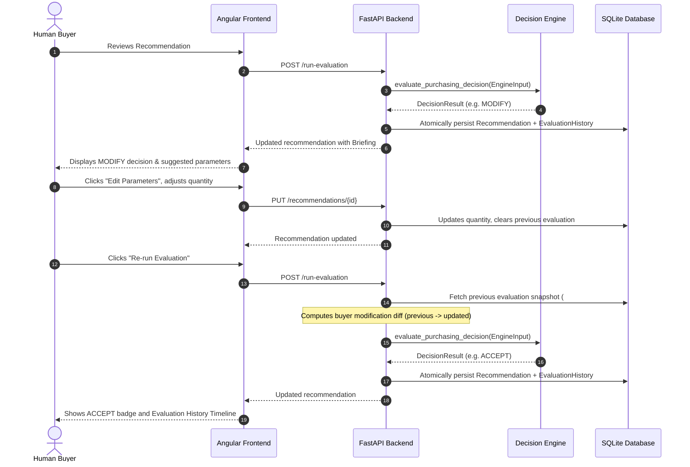

# AI Purchasing Agent: System Architecture

## 1. High-Level Architecture Overview

The AI Purchasing Agent is structured into four decoupled layers, separating user interaction, API routing, deterministic decision authority, and persistent audit history.



---

## 2. Layer Specifications

### 2.1. Presentation Layer (Angular 21 SPA)
- **Framework**: Angular 21 with Standalone Components and native Signals (`signal()`, `computed()`).
- **Dashboard (`/dashboard`)**: Metric cards (Total, Pending, Approved, Estimated Value), sortable recommendation table with decision/status badges.
- **Recommendation Detail (`/recommendations/:id`)**: Split view showing *Source Parameters* alongside *Strategic Purchasing Intelligence* and a chronological *Evaluation History Timeline*.
- **Recommendation Form (`/recommendations/new`, `/recommendations/:id/edit`)**: Dynamic dropdowns populated from catalog lookups, date validation, and status guards.

### 2.2. API & Service Layer (FastAPI)
- **Framework**: FastAPI (ASGI) with Pydantic v2 schemas and automatic OpenAPI Swagger docs.
- **Key Endpoints**:
  - `GET /api/recommendations`: List all recommendations.
  - `POST /api/recommendations`: Create a recommendation with date and catalog validation.
  - `PUT /api/recommendations/{id}`: Edit parameters in `PENDING_APPROVAL` status; resets evaluation state.
  - `POST /api/recommendations/{id}/run-evaluation`: Executes decision engine, diffs buyer changes, invokes Gemini briefing synthesis, and persists evaluation snapshot atomically.
  - `GET /api/recommendations/{id}/history`: Returns chronological evaluation history.
  - `POST /api/recommendations/{id}/approve`: Enforces human approval workflow.
  - `GET /api/catalog/products` & `GET /api/catalog/suppliers`: Lookup endpoints for user-friendly names.

### 2.3. Dual-Core Decision & Intelligence Engine

The core architecture strictly decouples **mathematical decision authority** from **natural language synthesis**:

```
[Raw Context Data]
       │
       ▼
[Deterministic Engine (engine.py)] ────► 100% Deterministic Decision Authority
       │                                  (Numbers, Facts, Constraints, Verdict)
       ▼
[DecisionResult Facts]
       │
       ▼
[Gemini AI Synthesizer (purchasing_agent.py)] ──► Explanation & Briefing Only
                                                 (Strategic Assessment, Trade-offs, Next Steps)
```

1. **Deterministic Decision Engine (`backend/app/decision_engine/`)**:
   - **`inventory.py`**: Chronologically simulates daily inventory levels, calculates daily demand burn rates, days of coverage, and isolates interim stockouts from final unmet demand.
   - **`suppliers.py`**: Evaluates supplier lead times, calculates MOQ excess units, and checks hard budget and storage constraints.
   - **`options.py`**: Ranks candidate options by timing feasibility, stockout prevention, lowest total cost, and minimal excess inventory. Generates unconfirmed investigation pathways.
   - **`engine.py`**: Synthesizes facts into one of four deterministic verdicts:
     - `ACCEPT`: Recommendation quantity and supplier are optimal and feasible.
     - `MODIFY`: Adjustments proposed to quantity or supplier to align with demand, MOQ, or lead time.
     - `REJECT`: On-hand stock and open POs fully cover demand; purchase is unnecessary.
     - `INVESTIGATE`: Hard constraint blocker (budget, storage) or lead times cannot prevent a stockout.
2. **AI Intelligence Synthesizer (`backend/app/agent/purchasing_agent.py`)**:
   - **Fact Grounding**: Prompts Gemini using verified numbers and calculations from `DecisionResult`. The LLM cannot override decisions or invent facts.
   - **Structured Executive Briefing**: Produces 3 clear sections: *Strategic Assessment*, *Supply & Operational Analysis*, and *Recommended Buyer Action Plan*.
   - **Graceful Fallback**: Automatically reverts to rule-based deterministic reasoning points if the API key is unconfigured or a network error occurs.

### 2.4. Persistence & Audit Layer (SQLite + SQLAlchemy 2.0)
- **Database**: SQLite 3 with global foreign key pragma enforcement.
- **Path Anchoring**: Root-anchored database path so the engine accesses the exact same database regardless of whether uvicorn is launched from root or `backend/`.
- **Automatic Initialization**: FastAPI lifespan hook automatically calls `init_db()` upon server startup.
- **Models**:
  - Catalog: `Product`, `Supplier`, `SupplierProduct`.
  - Inventory & Planning: `Inventory`, `DemandForecast`, `PurchaseOrder`, `PurchasingBudget`.
  - Workflow: `PurchaseRecommendation`.
  - Audit Trail: `EvaluationHistory` (stores immutable snapshots of evaluated quantity, supplier name, decision, explanation, calculations, and buyer modification deltas).

---

## 3. Human-in-the-Loop Feedback Workflow



---

## 4. Key Architectural Guarantees

| Invariant | Implementation Mechanism | Architectural Guarantee |
|---|---|---|
| **Deterministic Decision Authority** | Pure Python calculation engine | The LLM never decides purchase quantities or approval status; it only synthesizes explanations. |
| **Audit Immutability** | `EvaluationHistory` table | Prior evaluations and supplier names are permanently preserved as snapshots and never overwritten. |
| **Atomic State Persistence** | Transactional `try ... db.commit() ... except ... db.rollback()` | Recommendation state updates and history insertion commit together or roll back completely. |
| **Human Approval Control** | Backend `status == "PENDING_APPROVAL"` guard | No purchase orders are automatically placed; human buyers retain final decision authority. |
| **Workspace-Agnostic DB Connection** | Path-anchored `DATABASE_URL` in `session.py` | Backend resolves root database path consistently regardless of the terminal working directory. |

