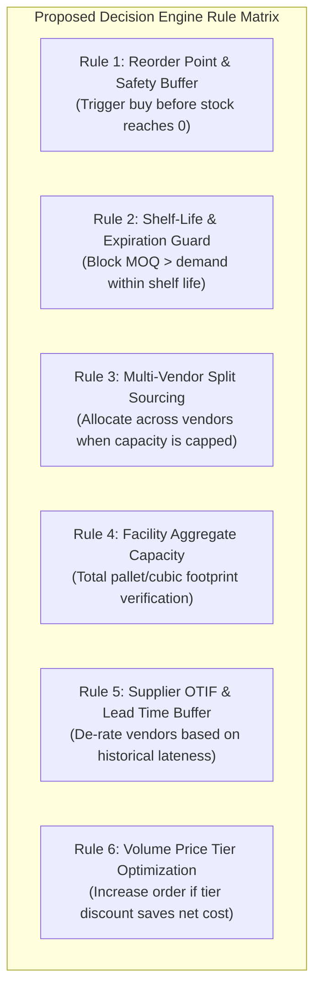

# AI Purchasing Agent: Failure Modes, Architectural Risks & Enhancement Roadmap

## 1. Executive Summary & System Context

The **AI Purchasing Agent** establishes a clean, decoupled architecture:
- **Separation of Concerns**: Pure Python deterministic calculations maintain mathematical decision authority, while Google Gemini is strictly confined to executive explanations.
- **Auditability**: Every evaluation run and buyer edit is recorded as an immutable snapshot in `EvaluationHistory`.
- **Human Governance**: Approvals remain human-controlled with strict status transitions.

However, transitioning from a Version 1 baseline to an **enterprise-grade production procurement system** reveals several failure modes, brittle hardcoded assumptions, and supply chain edge cases. This document details these failure modes (sorted by severity), analyzes what is currently hardcoded versus how to make it flexible, specifies additional decision-engine rules, and outlines a phased strategic enhancement roadmap.

---

## 2. Failure Modes & Vulnerability Matrix

Sorted by **Severity**: **Critical** $\rightarrow$ **High** $\rightarrow$ **Medium** $\rightarrow$ **Low**.

| ID | Failure Mode | Severity | Root Cause in Current Architecture | Real-World Operational Impact |
|:---|:---|:---:|:---|:---|
| **FM-1** | **Zero Safety Stock Blindspot (Catastrophic Stockout Risk)** | **CRITICAL** | `inventory.py`: Net requirement is calculated strictly as `demand - (on_hand + incoming_POs)`. Target inventory buffer is 0. | Any 1-day supplier delivery delay or minor demand spike results in immediate production line shutdown or stockout. |
| **FM-2** | **Supplier Capacity Blindspot (The "Scenario 2" Sourcing Failure)** | **CRITICAL** | `SupplierProduct`: Assumes infinite vendor capacity. No supplier availability or maximum order cap is modeled. | If a buyer needs 500 units but the vendor can only fulfill 250, the engine issues `ACCEPT` for 500, causing unfulfilled orders and factory halts. |
| **FM-3** | **Shared Warehouse Capacity Overflow** | **CRITICAL** | `inventory.py`: Storage capacity is checked per SKU (`available + incoming <= storage_capacity`), ignoring all other warehouse items. | Multiple SKU orders each pass individual storage checks, but collectively exceed physical facility capacity. |
| **FM-4** | **Uniform Demand Illusion (Flat Daily Burn Rate)** | **HIGH** | `inventory.py`: Daily burn rate is hardcoded as `forecast_quantity / forecast_days`. | Fails on lumpy demand (e.g. bulk batch manufacturing, weekend spikes). Interim stockouts occurring early in the period remain undetected. |
| **FM-5** | **All-or-Nothing Single Sourcing (No Order Splitting)** | **HIGH** | `engine.py` / `options.py`: Selects exactly one supplier per recommendation. | When no single vendor has sufficient capacity or short enough lead time, the engine outputs `INVESTIGATE` instead of splitting 300 to Supplier A and 200 to Supplier B. |
| **FM-6** | **Global Flat Budget Race Condition** | **HIGH** | `PurchasingBudget`: Single global bucket (`total_budget` minus `committed_amount`). No cost centers or multi-period tracking. | A large order for one product can consume the entire enterprise budget, starving critical purchases for all other products. |
| **FM-7** | **Single-Tier Approval Without Dollar Authority Limits** | **HIGH** | `recommendations.py`: Any user can approve any recommendation via `POST /approve`. | A junior buyer can approve a \$250,000 order with the same permissions used to approve a \$50 order. No approval delegation matrices exist. |
| **FM-8** | **Single-SKU Silo (Missing Bill of Materials / BOM)** | **MEDIUM** | Recommendations evaluate products in complete isolation. | Ordering 100 gears while required motors are on backorder ties up capital and warehouse space in unbuildable inventory. |
| **FM-9** | **Hardcoded Multi-Criteria Ranking Utility** | **MEDIUM** | `options.py`: Fixed ranking hierarchy (timing $\rightarrow$ unit price $\rightarrow$ MOQ excess). | During a supply crisis, a buyer cannot instruct the agent to prioritize speed or supplier reliability over lowest unit cost. |
| **FM-10** | **Prompt Inflexibility & Fixed Fallback Formatting** | **LOW** | `purchasing_agent.py`: Static 3-section prompt template; fallback is raw string-joined points. | Explanations cannot adapt tone or detail based on whether the reader is a plant manager, financial controller, or buyer. |

---

## 3. Deep-Dive: Hardcoded Assumptions vs. Flexible Implementations

### 3.1. Safety Stock & Reorder Buffer (FM-1)
* **Current Hardcoded Logic**:
  `inventory.py` computes:
  $$\text{Net Shortage} = \max(0, \text{Demand} - (\text{Available} + \text{Incoming POs}))$$
  If demand is 150 and current stock is 150, net shortage is 0, and the verdict is `REJECT` (do not buy).
* **The Failure**:
  Ending with 0 inventory leaves zero buffer. If a shipment is delayed by 12 hours or demand increases by 2 units, an immediate stockout occurs.
* **Flexible Solution**:
  Introduce **Statistical Safety Stock** or configurable coverage buffer:
  $$\text{Safety Stock} = Z \times \sigma_{\text{demand}} \times \sqrt{\text{Lead Time}} \quad \text{or} \quad \text{Target Coverage Days (e.g. 5 days)}$$
  $$\text{Target Order Qty} = \text{Demand} + \text{Safety Stock} - (\text{Available} + \text{Incoming})$$
  Allow category managers to configure service levels per SKU (e.g., 99% for critical Tier-1 parts, 90% for standard commodities).

---

### 3.2. Supplier Capacity & Dynamic Multi-Vendor Sourcing (FM-2 & FM-5)
* **Current Hardcoded Logic**:
  `options.py` iterates over suppliers and assumes each vendor can fulfill 100% of the requested order up to infinity, subject only to lead time and MOQ.
* **The Failure**:
  Suppliers frequently encounter capacity limits or inventory allocations. If Supplier A has only 250 units on hand and 500 units are needed, the current system:
  - Either places an unfulfillable 500-unit PO with Supplier A.
  - Or fails into `INVESTIGATE` if constraints trigger, even though sourcing 250 from Supplier A and 250 from Supplier B would prevent a plant shutdown.
* **Flexible Solution**:
  - Add `available_capacity` and `max_order_quantity` to `SupplierProduct`.
  - Upgrade the option ranker to a **Knapsack / Linear Programming Allocator**:
    $$\min \sum (c_i \cdot q_i) \quad \text{subject to} \quad \sum q_i = \text{Total Demand}, \quad q_i \le \text{Capacity}_i$$
  - Support `SPLIT_ORDER` as an actionable decision type.

---

### 3.3. Warehouse Capacity: Single-SKU vs Aggregate Facility (FM-3)
* **Current Hardcoded Logic**:
  `Inventory.storage_capacity` is defined per SKU. If SKU A has capacity 500 and SKU B has capacity 500, each runs an isolated check:
  `if (available + incoming) > storage_capacity: return INVESTIGATE`.
* **The Failure**:
  If the warehouse has 600 total pallet spots, and SKU A orders 400 and SKU B orders 400, both pass their isolated checks (400 $\le$ 500). When shipments arrive, 800 pallets show up at a 600-pallet warehouse, forcing demurrage fees or offsite spillover costs.
* **Flexible Solution**:
  - Model a `Warehouse` entity with `total_pallet_bays` or `total_cubic_meters`.
  - Add `unit_volume` / `pallet_footprint` to `Product`.
  - Check facility-wide utilization across all active stock and pending inbound orders.

---

### 3.4. Non-Linear Demand & Discrete Daily Time-Bucketing (FM-4)
* **Current Hardcoded Logic**:
  `daily_demand_rate = forecast_quantity / forecast_days`.
  A forecast of 300 units over 30 days is treated as a flat 10 units/day.
* **The Failure**:
  If a manufacturing run consumes 250 units on Day 3, and only 50 units across the remaining 27 days, the flat model predicts stock will last 20+ days. In reality, the stockout occurs on Day 3.
* **Flexible Solution**:
  - Transition from a single aggregate forecast number to a **Daily Demand Series** `[d_1, d_2, ... d_n]`.
  - The chronological simulation in `inventory.py` already supports day-by-day stepping; passing discrete daily demand vectors immediately unlocks accurate lumpy demand simulation.

---

### 3.5. Multi-Criteria Ranking Weights & Buyer Objectives (FM-9)
* **Current Hardcoded Logic**:
  In `options.py`, options are sorted by a rigid hardcoded tuple:
  `(-timing_feasible, -stockout_prevented, total_cost, excess_over_shortage)`.
* **The Failure**:
  Procurement priorities shift based on business conditions:
  - *Normal Operations*: Minimize total landed cost.
  - *Supply Chain Crisis*: Minimize lead time; cost is secondary.
  - *Strategic Sourcing*: Direct 20% of spend to preferred or high-ESG suppliers.
* **Flexible Solution**:
  Implement a **Configurable Objective Scoring Function**:
  $$\text{Score} = w_{\text{cost}} \cdot S_{\text{cost}} + w_{\text{speed}} \cdot S_{\text{speed}} + w_{\text{quality}} \cdot S_{\text{reliability}} - w_{\text{moq\_waste}} \cdot S_{\text{excess}}$$
  Expose procurement policy presets in the UI (e.g. "Preserve Working Capital" vs "Stockout Zero-Tolerance").

---

### 3.6. Corporate Governance & Tiered Approval Limits (FM-7)
* **Current Hardcoded Logic**:
  `POST /api/recommendations/{id}/approve` checks only:
  `if recommendation.status != "PENDING_APPROVAL": raise 400`.
* **The Failure**:
  Zero authorization governance. Any client can approve orders of unlimited dollar value.
* **Flexible Solution**:
  Introduce **Approval Authority Matrices**:
  - **Tier 1** ($\le \$5,000$): Auto-approved or Junior Buyer approval.
  - **Tier 2** ($\$5,001 - \$50,000$): Procurement Manager sign-off.
  - **Tier 3** ($> \$50,000$): VP Supply Chain / CFO authorization.
  - Record `approved_by_user_id` and `approval_tier` on the recommendation.

---

## 4. Enhanced Decision Engine Rule Matrix

To significantly strengthen the deterministic engine's rigor, six new rules should be incorporated:

### Detailed Rule Specifications

1. **Rule 1: Reorder Point (ROP) & Safety Stock**:
   - *Logic*: Trigger recommendation when:
     $$\text{Available Stock} + \text{Inbound POs} \le (\text{Daily Demand Rate} \times \text{Lead Time}) + \text{Safety Stock}$$
   - *Outcome*: Proactive replenishment before stock reaches zero.

2. **Rule 2: Shelf-Life & Expiration Guard**:
   - *Logic*: If `suggested_quantity` (due to high supplier MOQ) exceeds forecasted demand over the product's remaining shelf-life:
   - *Outcome*: Output `INVESTIGATE` with warning: *"Supplier MOQ of 500 units will result in 180 expired units before consumption."*

3. **Rule 3: Multi-Vendor Split Sourcing**:
   - *Logic*: If primary supplier capacity $< \text{net shortage}$, query secondary suppliers to fulfill the remainder.
   - *Outcome*: Output `MODIFY` with split allocation (e.g. 250 units to Supplier A, 250 units to Supplier B).

4. **Rule 4: Facility-Wide Aggregate Storage**:
   - *Logic*: Calculate $\sum (\text{item\_volume} \times \text{units})$ across all SKUs against `Warehouse.total_capacity`.
   - *Outcome*: Reject or hold orders that breach facility footprint.

5. **Rule 5: Supplier On-Time In-Full (OTIF) Adjustment**:
   - *Logic*: Apply a dynamic safety buffer to vendor lead times:
     $$\text{Effective Lead Time} = \text{Contract Lead Time} + \text{Historical Delay P90}$$
   - *Outcome*: Prevents optimistic stockout simulations based on suppliers that routinely deliver late.

6. **Rule 6: Volume Price Tier Optimization**:
   - *Logic*: If buying 90 units at \$10 costs \$900, but an MOQ tier of 100 units at \$7 costs \$700:
   - *Outcome*: Suggest increasing order quantity to 100 units, unlocking a net savings of \$200.

---

## 5. Phased Strategic Roadmap

```mermaid
flowchart LR
    subgraph Phase1 ["Phase 1: High-Impact Engine Upgrades"]
        P1A["Safety Stock & Reorder Points"]
        P1B["Discrete Daily Demand Series"]
        P1C["Approval Value Thresholds (RBAC)"]
    end

    subgraph Phase2 ["Phase 2: Supply Network Realities"]
        P2A["Supplier Capacity & Split Sourcing"]
        P2B["Aggregate Warehouse Footprint"]
        P2C["Volume Price Tier Optimization"]
    end

    subgraph Phase3 ["Phase 3: Autonomous Agent Capabilities"]
        P3A["Multi-Agent Supplier Inquiries / Tools"]
        P3B["Configurable Buyer Strategy Presets"]
        P3C["ERP Integration (Draft PO in SAP/NetSuite)"]
    end

    Phase1 --> Phase2 --> Phase3
```

### Phase 1: High-Impact Engine Upgrades (Near-Term)
- Add `safety_stock_days` to `Inventory` and incorporate into shortage calculations.
- Pass discrete daily demand arrays into `inventory.py` to capture early-period stockout spikes.
- Introduce dollar-based approval thresholds (`POST /api/recommendations/{id}/approve`).

### Phase 2: Supply Network Realities (Mid-Term)
- Add `available_capacity` to `SupplierProduct` and enable split-sourcing recommendations in `options.py`.
- Introduce `Warehouse` model for aggregate storage capacity checks.
- Add volume tier pricing support to commercial terms.

### Phase 3: Autonomous Agent Capabilities (Long-Term)
- Enable tool-calling for the AI agent (e.g. querying carrier APIs, checking ERP purchase order status).
- Allow buyers to select policy presets (e.g. *Low Cost*, *Fastest Delivery*, *Balanced Risk*).
- Integrate outbound webhook to draft Purchase Orders directly in external ERP systems (SAP, NetSuite, Coupa) upon human approval.

