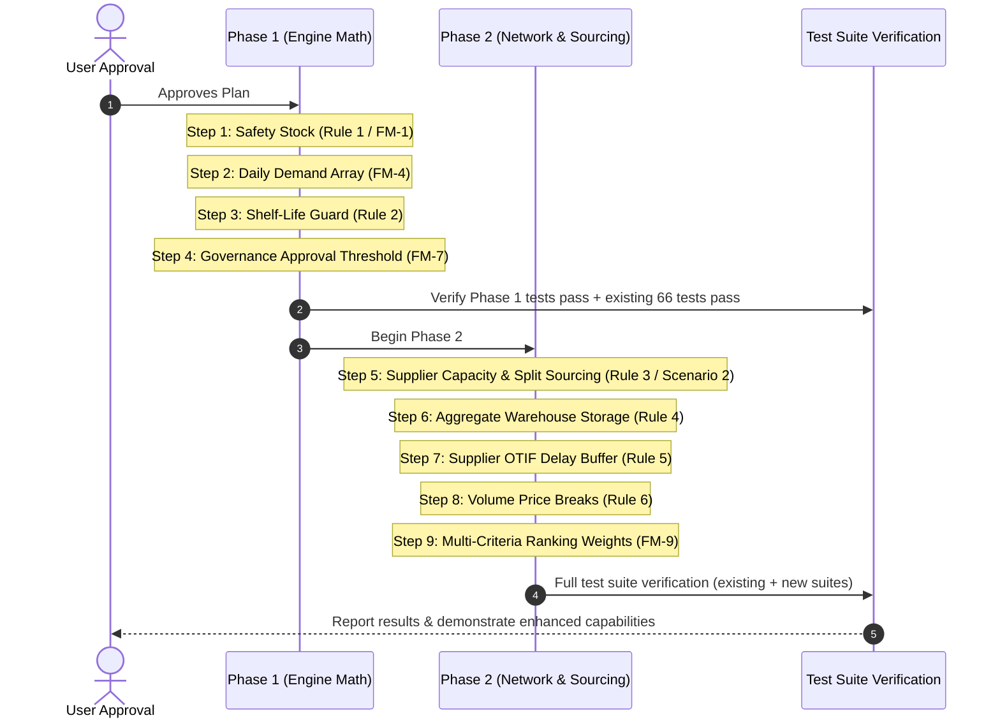

# Implementation Plan: Decision Engine Enhancements & Advanced Rules (Phase 1 & Phase 2)

## 1. Overview & Objective

This implementation plan delivers **Phase 1** and **Phase 2** of the system roadmap documented in [`docs/failure-modes-and-roadmap.md`](../docs/failure-modes-and-roadmap.md). 

It transitions the AI Purchasing Agent from a baseline prototype into a hardened, realistic decision engine by:
- Solving **all 3 Critical failure modes** (`FM-1`, `FM-2`, `FM-3`) and **core High-severity vulnerabilities** (`FM-4`, `FM-5`, `FM-7`, `FM-9`).
- Adding **6 advanced decision-engine rules** (Rules 1 through 6).
- Directly resolving the **Assignment Scenario 2 requirement** (split-sourcing when a supplier can only fulfill a partial order of 250 units against a 500-unit requirement).
- Preserving **100% backward compatibility** with all existing 66 backend tests and 26 frontend unit tests.

> [!NOTE]
> **Out of Scope (Phase 3)**:
> External ERP integration (SAP/NetSuite webhooks), live carrier tracking APIs, and autonomous supplier email agents are strictly out of scope for this implementation. They remain preserved in documentation as strategic talking points for technical interviews.

---

## 2. Phase 1: Pure Engine Math & High-Impact Safety Rules (Zero Breaking Schema Changes)

Phase 1 focuses on internal calculation logic, safety buffers, and governance thresholds. All additions use optional defaults to avoid breaking existing data models or APIs.

### 2.1. Step 1: Safety Stock & Reorder Buffer (Rule 1 / Solves FM-1)
* **File to modify**: `backend/app/decision_engine/types.py`, `backend/app/decision_engine/inventory.py`
* **Changes**:
  1. Add optional `safety_stock_quantity: int = 0` to `InventoryInput` (default `0` ensures 100% backward compatibility).
  2. In `inventory.py`, incorporate safety stock into the net shortage calculation:
     $$\text{Gross Requirement} = \text{forecast\_quantity} + \text{safety\_stock\_quantity}$$
     $$\text{Net Shortage} = \max(0, \text{Gross Requirement} - (\text{available\_quantity} + \text{open\_order\_total}))$$
  3. Include `safety_stock_quantity` and `target_ending_inventory` in `StockoutTimelineAnalysis.calculations` and reasoning points.

### 2.2. Step 2: Discrete Daily Demand Series Simulation (Solves FM-4)
* **File to modify**: `backend/app/decision_engine/types.py`, `backend/app/decision_engine/inventory.py`
* **Changes**:
  1. Add optional `daily_demand_series: Optional[List[int]] = None` to `DemandForecastInput`.
  2. In `inventory.py`:
     - If `daily_demand_series` is provided: step through each day using discrete daily consumption values `daily_demand_series[day_index]`. This catches early-period consumption spikes that would be hidden by flat averages.
     - If `daily_demand_series` is `None`: fallback gracefully to the current flat rate `forecast_quantity / forecast_days`.

### 2.3. Step 3: Shelf-Life & Spoilage Guard (Rule 2)
* **File to modify**: `backend/app/decision_engine/types.py`, `backend/app/decision_engine/suppliers.py`
* **Changes**:
  1. Add optional `shelf_life_days: Optional[int] = None` to `EngineInput` / `ProductInput`.
  2. In `suppliers.py`:
     - If `shelf_life_days` is specified: compute projected demand over `shelf_life_days`.
     - If supplier MOQ forces an order quantity greater than total demand during the shelf-life period:
       $$\text{Spoilage Risk} = \text{order\_quantity} - \text{demand\_within\_shelf\_life}$$
     - Add warning to `trade_offs`: *"Supplier MOQ of {moq} creates {spoilage} units at risk of expiring before consumption."*
     - If spoilage exceeds 25% of the order, flag `is_feasible = False` with a blocker warning.

### 2.4. Step 4: Governance Approval Dollar Threshold (Solves FM-7)
* **File to modify**: `backend/app/api/recommendations.py`, `backend/app/api/schemas.py`
* **Changes**:
  1. Define a configurable governance limit in backend settings (default: `$10,000.00`).
  2. In `POST /api/recommendations/{id}/approve`:
     - Calculate estimated order value: `recommended_quantity * unit_price`.
     - If `order_value > threshold` and no `manager_override: bool = True` is provided in the request body, return `400 Bad Request` or `403 Forbidden` with a clear message: *"Order value ($15,000.00) exceeds standard approval limit ($10,000.00). Manager authorization required."*
     - Preserves approval workflow for standard orders while enforcing governance on high-value commitments.

---

## 3. Phase 2: Supply Network Realities & Multi-Vendor Sourcing

Phase 2 introduces vendor capacity limits, multi-supplier order splitting, aggregate facility storage, supplier lateness penalties, and volume price breaks.

### 3.1. Step 5: Supplier Capacity & Multi-Vendor Split Sourcing (Rule 3 / Solves FM-2 & FM-5, Scenario 2 Fix)
* **Files to modify**:
  - `backend/app/models/supplier_product.py`
  - `backend/app/decision_engine/types.py`
  - `backend/app/decision_engine/options.py`
  - `backend/app/decision_engine/engine.py`
* **Changes**:
  1. Add optional column `available_capacity: Optional[int] = None` (nullable, default `None` = unlimited) to `SupplierProduct`.
  2. In `types.py`, add `available_capacity: Optional[int] = None` to `SupplierProductInput`.
  3. Add `SplitSourcingOption` dataclass:
     ```python
     @dataclass
     class SplitOrderAllocation:
         primary_supplier_id: int
         primary_quantity: int
         primary_cost: float
         secondary_supplier_id: int
         secondary_quantity: int
         secondary_cost: float
         total_cost: float
     ```
  4. In `options.py`:
     - When evaluating suppliers, if the lowest-cost or fastest supplier has `available_capacity < net_shortage`:
       - Allocate `primary_quantity = supplier.available_capacity`.
       - Query secondary suppliers for remaining `shortage - primary_quantity`.
       - Generate a valid `SplitSourcingOption` combining both suppliers.
  5. In `engine.py`:
     - If no single supplier can fulfill the full shortage due to capacity caps, but a split allocation fulfills the demand on time within budget:
     - Output decision `MODIFY` with `agent_suggested_quantity = net_shortage`, and populate `split_allocations` in `calculations` and `reasoning_points` (e.g. *"Supplier A confirms 250 units; remaining 250 units sourced from Supplier B"*).

### 3.2. Step 6: Facility-Wide Aggregate Storage Capacity (Rule 4 / Solves FM-3)
* **Files to modify**:
  - `backend/app/decision_engine/types.py`
  - `backend/app/decision_engine/suppliers.py`
* **Changes**:
  1. Add optional `unit_volume_m3: float = 1.0` to `Product` / `EngineInput`.
  2. Add optional `facility_available_m3: Optional[float] = None` to `EngineInput`.
  3. In `suppliers.py`:
     - If `facility_available_m3` is provided: compute `order_volume = order_quantity * unit_volume_m3`.
     - Flag `is_storage_feasible = False` if `order_volume > facility_available_m3`, with warning: *"Order requires {order_volume} m³, exceeding available warehouse facility space ({facility_available_m3} m³)."*

### 3.3. Step 7: Supplier On-Time In-Full (OTIF) Historical Lateness Buffer (Rule 5)
* **Files to modify**:
  - `backend/app/decision_engine/types.py`
  - `backend/app/decision_engine/suppliers.py`
* **Changes**:
  1. Add optional `historical_delay_days: int = 0` to `SupplierProductInput`.
  2. In `suppliers.py`:
     $$\text{Effective Lead Time} = \text{lead\_time\_days} + \text{historical\_delay\_days}$$
     $$\text{Effective Arrival Date} = \text{evaluation\_date} + \text{timedelta}(\text{effective\_lead\_time})$$
  3. Use `effective_arrival_date` for timing feasibility checks.
  4. If `historical_delay_days > 0`, log in trade-offs: *"Supplier lead time padded by {historical_delay_days} day(s) based on historical delivery variance."*

### 3.4. Step 8: Volume Price Break Discount Tier Optimization (Rule 6)
* **Files to modify**:
  - `backend/app/decision_engine/types.py`
  - `backend/app/decision_engine/suppliers.py`
* **Changes**:
  1. Add `PriceTier` dataclass to `types.py`:
     ```python
     @dataclass
     class PriceTier:
         min_quantity: int
         unit_price: Decimal
     ```
  2. In `suppliers.py`:
     - Evaluate if an order quantity just below a discount tier could be increased to save money:
       $$\text{Current Cost} = \text{order\_qty} \times \text{base\_price}$$
       $$\text{Tier Cost} = \text{tier\_min\_qty} \times \text{tier\_discount\_price}$$
     - If $\text{Tier Cost} < \text{Current Cost}$ and storage permits:
       - Recommend increasing quantity to `tier_min_qty`.
       - Add note: *"Increasing order from {order_qty} to {tier_min_qty} units unlocks tier discount of ${tier_discount_price}/unit, saving ${Current Cost - Tier Cost} net."*

### 3.5. Step 9: Multi-Criteria Ranking Utility Scoring (Solves FM-9)
* **Files to modify**: `backend/app/decision_engine/options.py`
* **Changes**:
  1. Add optional `ranking_weights: RankingWeights` to `EngineInput` (defaults: cost=0.4, speed=0.4, moq_waste=0.2).
  2. Normalize options across timing, cost, and excess units into a composite score:
     $$\text{Composite Score} = w_{\text{speed}} \cdot S_{\text{timing}} + w_{\text{cost}} \cdot S_{\text{cost}} - w_{\text{waste}} \cdot S_{\text{excess}}$$
  3. Sort candidate options using composite score after eliminating hard constraint blockers.

---

## 4. Test Strategy & Quality Verification

### 4.1. Unit Test Coverage
Create dedicated test files under `backend/tests/`:
- `test_safety_stock_and_reorder.py`:
  - Verify net shortage increases by safety stock amount.
  - Verify zero-stockout prevention when buffer days are configured.
- `test_split_sourcing.py`:
  - Verify Assignment Scenario 2: 500-unit requirement with 250-unit primary supplier cap successfully splits across Supplier A (250) and Supplier B (250).
  - Verify cost and delivery tracking for both split orders.
- `test_advanced_rules.py`:
  - Shelf-life spoilage guard triggering `INVESTIGATE`.
  - OTIF historical lateness padding turning a marginally feasible supplier into late.
  - Volume price tier suggestion saving net expenditure.
  - Governance threshold on `POST /approve`.

### 4.2. Regression & Baseline Verification
- Run existing 66 backend tests (`pytest backend/tests`) to guarantee 100% backward compatibility.
- Run frontend unit tests (`cd frontend && npx ng test --no-watch`) to ensure UI compatibility.

---

## 5. Execution Sequence



---

## 6. Approval Request

Please review this implementation plan. Once you give your approval to proceed, implementation will begin strictly following this phased sequence.

