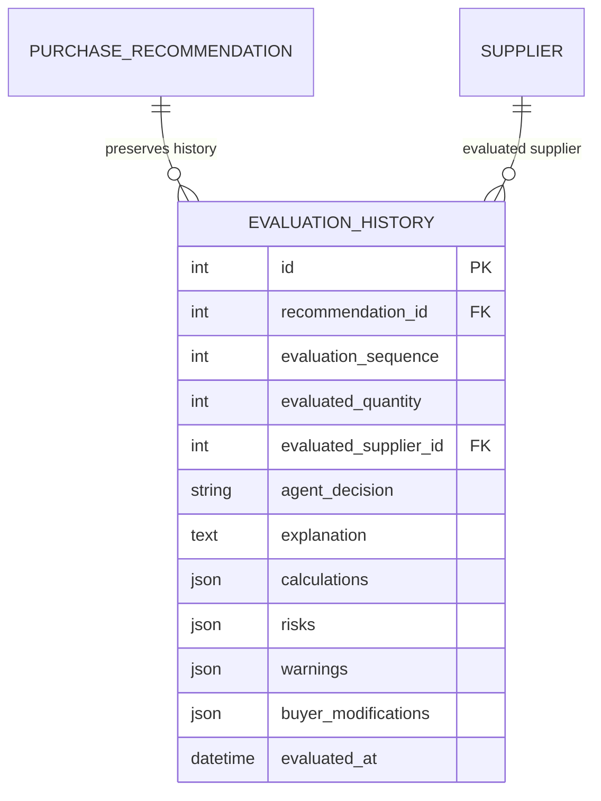
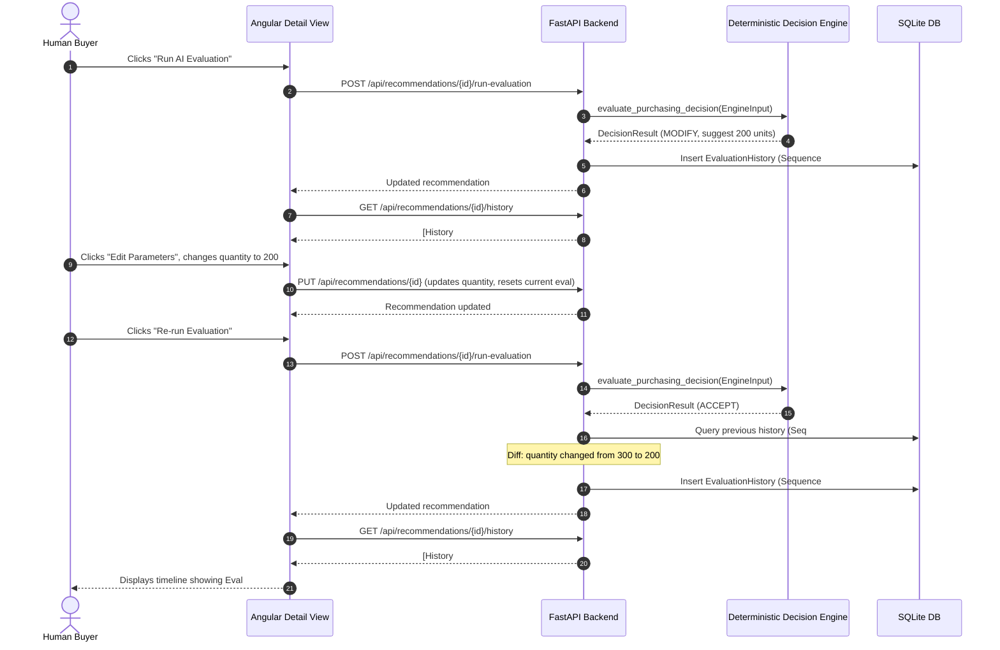

# Revised Implementation Plan: Feedback Loop History & Evaluation Tracking (V1)

## Executive Summary

The objective of this revised plan is to make the buyer feedback loop **visible, traceable, and demonstrable** for Version 1.

> [!IMPORTANT]
> **Scope Boundaries**:
> - The Gemini re-evaluation issue is handled separately. This plan does not modify prompt logic or duplicate that work.
> - The deterministic decision engine rules and calculations remain **completely untouched**.
> - No generic audit logging frameworks or additional agent orchestrators are introduced.
> - Approval remains a separate human-controlled action with no automated purchasing.

---

## 1. Required Model Changes

### 1.1. `EvaluationHistory` Model (`backend/app/models/evaluation_history.py`)

A minimal, dedicated SQLite table `evaluation_history` to preserve every evaluation run immutably:



#### Field Specifications:
- `id`: `Integer`, Primary Key, autoincrement.
- `recommendation_id`: `Integer`, `ForeignKey("purchase_recommendations.id", ondelete="CASCADE")`, nullable=False, indexed.
- `evaluation_sequence`: `Integer`, nullable=False (1, 2, 3...).
- `evaluated_quantity`: `Integer`, nullable=False (quantity snapshot evaluated).
- `evaluated_supplier_id`: `Integer`, `ForeignKey("suppliers.id", ondelete="SET NULL")`, nullable=True, indexed.
- `agent_decision`: `String(20)`, nullable=False (`ACCEPT`, `MODIFY`, `REJECT`, `INVESTIGATE`).
- `explanation`: `Text`, nullable=True (the explanation/reasoning generated for this evaluation).
- `calculations`: `JSON`, nullable=True (snapshot of calculations like daily burn rate, stockout dates, net shortage).
- `risks`: `JSON`, nullable=True (snapshot of risks identified).
- `warnings`: `JSON`, nullable=True (snapshot of warnings identified).
- `buyer_modifications`: `JSON`, nullable=True (minimal dictionary tracking changes made by the buyer since the previous evaluation; `None` for sequence #1).
- `evaluated_at`: `DateTime`, nullable=False, default UTC now.

#### Relationships & Helpers:
- `recommendation`: `relationship("PurchaseRecommendation", back_populates="evaluation_history")`
- `evaluated_supplier`: `relationship("Supplier", foreign_keys=[evaluated_supplier_id])`
- Property `evaluated_supplier_name`: Returns `evaluated_supplier.supplier_name` or `None`.

### 1.2. `PurchaseRecommendation` Model Updates (`backend/app/models/purchase_recommendation.py`)
Add relationship:
```python
evaluation_history = relationship(
    "EvaluationHistory",
    back_populates="recommendation",
    cascade="all, delete-orphan",
    order_by="EvaluationHistory.evaluation_sequence.asc()",
)
```

### 1.3. Model Registration
- Export `EvaluationHistory` in `backend/app/models/__init__.py`.
- Import `app.models.evaluation_history` in `backend/app/database/session.py:init_db()`.

---

## 2. Required API Changes

### 2.1. Pydantic Schemas (`backend/app/api/schemas.py`)

```python
class ValueChange(BaseModel):
    previous: Any
    updated: Any
    previous_name: Optional[str] = None
    updated_name: Optional[str] = None

class BuyerModifications(BaseModel):
    quantity: Optional[ValueChange] = None
    supplier: Optional[ValueChange] = None

class EvaluationHistoryResponse(BaseModel):
    model_config = ConfigDict(from_attributes=True)

    id: int
    recommendation_id: int
    evaluation_sequence: int
    evaluated_quantity: int
    evaluated_supplier_id: Optional[int] = None
    evaluated_supplier_name: Optional[str] = None
    agent_decision: str
    explanation: Optional[str] = None
    calculations: Optional[Dict[str, Any]] = None
    risks: Optional[List[str]] = None
    warnings: Optional[List[str]] = None
    buyer_modifications: Optional[BuyerModifications] = None
    evaluated_at: datetime
```

### 2.2. Evaluation History Persistence in `run-evaluation` (`backend/app/api/recommendations.py`)

In `run_evaluation_with_engine` (`POST /api/recommendations/{recommendation_id}/run-evaluation`):
1. **Fetch Prior Run**:
   ```python
   previous_run = (
       db.query(EvaluationHistory)
       .filter_by(recommendation_id=recommendation.id)
       .order_by(EvaluationHistory.evaluation_sequence.desc())
       .first()
   )
   ```
2. **Compute Buyer Modifications (V1 Minimal)**:
   - If no prior run:
     - `sequence = 1`
     - `buyer_modifications = None`
   - If prior run exists:
     - `sequence = previous_run.evaluation_sequence + 1`
     - Track only quantity and supplier:
       ```python
       mods = {}
       if recommendation.recommended_quantity != previous_run.evaluated_quantity:
           mods["quantity"] = {
               "previous": previous_run.evaluated_quantity,
               "updated": recommendation.recommended_quantity,
           }
       if recommendation.supplier_id != previous_run.evaluated_supplier_id:
           old_name = previous_run.evaluated_supplier_name
           new_name = recommendation.supplier_name
           mods["supplier"] = {
               "previous": previous_run.evaluated_supplier_id,
               "updated": recommendation.supplier_id,
               "previous_name": old_name,
               "updated_name": new_name,
           }
       buyer_modifications = mods if mods else None
       ```
3. **Persist Immutable Record**:
   ```python
   history_entry = EvaluationHistory(
       recommendation_id=recommendation.id,
       evaluation_sequence=sequence,
       evaluated_quantity=recommendation.recommended_quantity,
       evaluated_supplier_id=recommendation.supplier_id,
       agent_decision=decision_result.decision,
       explanation=recommendation.agent_reasoning,
       calculations=decision_result.calculations,
       risks=decision_result.risks,
       warnings=decision_result.warnings,
       buyer_modifications=buyer_modifications,
       evaluated_at=datetime.now(timezone.utc),
   )
   db.add(history_entry)
   db.commit()
   ```

### 2.3. History Retrieval Endpoint (`backend/app/api/recommendations.py`)

```python
@router.get(
    "/{recommendation_id}/history",
    response_model=List[EvaluationHistoryResponse],
)
def get_recommendation_history(
    recommendation_id: int,
    db: Session = Depends(get_db),
):
    """Returns chronological evaluation history for a recommendation."""
    rec = db.query(PurchaseRecommendation).filter_by(id=recommendation_id).first()
    if not rec:
        raise HTTPException(
            status_code=status.HTTP_404_NOT_FOUND,
            detail="Purchase recommendation not found",
        )

    return (
        db.query(EvaluationHistory)
        .filter_by(recommendation_id=recommendation_id)
        .order_by(EvaluationHistory.evaluation_sequence.asc())
        .all()
    )
```

---

## 3. Required Frontend Changes

### 3.1. Models (`frontend/src/app/core/models/recommendation.model.ts`)
Add frontend models:
- `ValueChange`: `{ previous: any; updated: any; previous_name?: string; updated_name?: string }`
- `BuyerModifications`: `{ quantity?: ValueChange; supplier?: ValueChange }`
- `EvaluationHistoryItem`: Schema mapping `EvaluationHistoryResponse`.

### 3.2. Service (`frontend/src/app/core/services/recommendation.service.ts`)
Add:
```typescript
getHistory(id: number): Observable<EvaluationHistoryItem[]> {
  return this.http.get<EvaluationHistoryItem[]>(`${this.baseUrl}/${id}/history`);
}
```

### 3.3. Recommendation Detail UI (`frontend/src/app/features/recommendation-detail/recommendation-detail.component.ts`)
Add an **Evaluation History Timeline** to the details page:
- **Placement**: Underneath the existing two columns ("Original Purchasing Recommendation" and "Strategic Purchasing Intelligence").
- **Timeline Structure**:
  - Vertical list / cards showing each evaluation run in chronological order.
  - Header: `Evaluation #<sequence>` with a badge for `agent_decision` (`ACCEPT`, `MODIFY`, `REJECT`, `INVESTIGATE`) and timestamp.
  - Inputs evaluated: `Evaluated Quantity: <quantity> units` | `Supplier: <supplier_name>`.
  - **Buyer Modifications Callout** (if present):
    - Example: *Buyer changed quantity from 300 → 200 units*
    - Example: *Buyer changed supplier from Acme Industrial Supplies → QuickParts Express*
  - Explanation: Displays the explanation recorded with that run.
  - Latest evaluation card highlighted with an active badge (`Latest Evaluation`).
- **Dynamic Behavior**:
  - Fetches history on `ngOnInit`.
  - Automatically re-fetches history whenever `onRunEvaluation()` finishes.
  - Handles loading and empty states cleanly.

---

## 4. End-to-End Workflow



---

## 5. Essential Tests (Phase 5)

Only the **6 focused tests** requested:

1. **First evaluation creates a history record**:
   - Running evaluation for a new recommendation creates an `EvaluationHistory` record with `evaluation_sequence = 1` and `buyer_modifications = None`.
2. **Subsequent evaluation creates another record**:
   - Re-evaluating adds a new record with `evaluation_sequence = 2`.
3. **Previous evaluation remains unchanged**:
   - Verify all fields of sequence #1 (`evaluated_quantity`, `agent_decision`, `explanation`) remain identical after sequence #2 is created.
4. **Buyer quantity modifications recorded correctly**:
   - When quantity is modified before re-evaluation, sequence #2 captures `buyer_modifications["quantity"] = {"previous": 300, "updated": 200}`.
5. **Buyer supplier modifications recorded correctly**:
   - When supplier is modified before re-evaluation, sequence #2 captures `buyer_modifications["supplier"] = {"previous": 1, "updated": 3, ...}`.
6. **History API returns evaluations in chronological order**:
   - `GET /api/recommendations/{id}/history` returns sequence #1 followed by sequence #2 with all metadata.

---

## 6. Implementation Sequence

1. **Step 1**: Create `EvaluationHistory` model in `backend/app/models/evaluation_history.py`, register in `models/__init__.py`, `session.py`, and link to `PurchaseRecommendation`.
2. **Step 2**: Add Pydantic response schemas in `backend/app/api/schemas.py`.
3. **Step 3**: Update `run_evaluation_with_engine` in `backend/app/api/recommendations.py` to calculate buyer deltas and insert `EvaluationHistory` records.
4. **Step 4**: Implement `GET /api/recommendations/{id}/history` in `backend/app/api/recommendations.py`.
5. **Step 5**: Update frontend models (`recommendation.model.ts`) and service (`recommendation.service.ts`).
6. **Step 6**: Add the vertical history timeline to `recommendation-detail.component.ts`.
7. **Step 7**: Implement the 6 essential tests in `backend/tests/test_evaluation_history.py` and run test suite verification (`pytest` and `ng test`).
