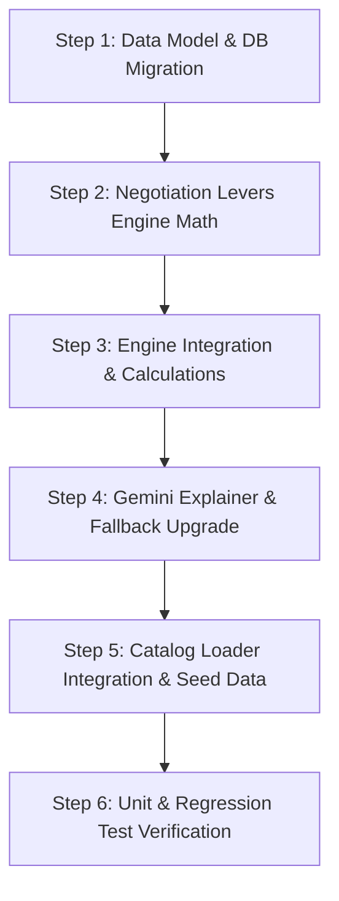

# Implementation Plan: Actionable Negotiation Levers, Vendor Flexibility & Gemini Strategic Briefings

## 1. Overview & Objective

This implementation plan upgrades the AI Purchasing Agent from a passive validator into an **active procurement advisor**.

### Key Deliverables:
1. **Vendor Flexibility & Capacity Modeling**:
   - Model fulfillment capacity (`available_capacity`), vendor MOQ flexibility (`is_moq_negotiable: bool = True`), and emergency rush capability (`expedited_lead_time_days: Optional[int] = None`) on `SupplierProduct` and `SupplierProductInput`.
2. **Deterministic Quantified Negotiation Levers**:
   - Upgrade the decision engine to output concrete, mathematically exact negotiation targets:
     - **Lead Time Expediting**: Exact target day reduction ($N$ days) and target delivery date to avert stockout.
     - **MOQ Reduction Lever**: Exact excess inventory holding cost eliminated ($(\text{MOQ} - \text{shortage}) \times \text{unit\_price}$) if MOQ is waived/reduced.
     - **Price Benchmark Counter-Offer**: Exact dollar savings ($(\text{price}_{\text{incumbent}} - \text{price}_{\text{alt}}) \times \text{quantity}$) by benchmarking against qualified lower-cost alternatives.
     - **Partial Batch Delivery**: Split urgent batch needed prior to stockout date from the remainder.
3. **Structured Data Contract**:
   - Introduce `NegotiationLever` dataclass and serialize within `decision_result.calculations["negotiation_levers"]` and `decision_result.investigation_options`.
4. **Gemini AI Procurement Briefing & Deterministic Fallback**:
   - Update prompt in `backend/app/agent/purchasing_agent.py` to synthesize these exact numbers into a dedicated subsection:
     - **"Buyer Negotiation Strategy & Counter-Offers"** with 2–3 ready-to-use talking points for vendor calls/emails.
   - Upgrade the deterministic fallback to render the same structured executive briefing with exact negotiation figures when `GEMINI_API_KEY` is not present or offline.
5. **Quality Verification**:
   - Dedicated unit test suite `backend/tests/test_negotiation_levers.py` verifying all four lever formulas, vendor flexibility, and prompt/fallback outputs.
   - Regression verification across all existing 79 backend tests and 27 frontend tests.

---

## 2. Proposed Architecture & Data Models

### 2.1. Data Models (`backend/app/models/supplier_product.py` & DB Migration)
```python
# Added to SupplierProduct:
is_moq_negotiable = Column(Boolean, nullable=False, default=True)
expedited_lead_time_days = Column(Integer, nullable=True)
```
- In `backend/app/database/session.py`: automatic schema migration `ALTER TABLE supplier_products ADD COLUMN ...` if columns do not exist.

### 2.2. Decision Engine Types (`backend/app/decision_engine/types.py`)
```python
@dataclass(frozen=True)
class NegotiationLever:
    lever_type: Literal[
        "LEAD_TIME_EXPEDITE",
        "MOQ_REDUCTION",
        "PRICE_BENCHMARK_COUNTER_OFFER",
        "PARTIAL_BATCH_DELIVERY"
    ]
    title: str
    target_supplier_id: int
    target_supplier_name: str
    current_value: str
    target_value: str
    potential_savings: Optional[float]
    recommended_talking_point: str

@dataclass(frozen=True)
class SupplierProductInput:
    supplier_id: int
    supplier_name: str
    unit_price: Decimal
    lead_time_days: int
    minimum_order_quantity: int
    available_capacity: Optional[int] = None
    historical_delay_days: int = 0
    price_tiers: Optional[List[PriceTier]] = None
    is_moq_negotiable: bool = True
    expedited_lead_time_days: Optional[int] = None
```

---

## 3. Decision Engine Negotiation Math (`backend/app/decision_engine/options.py`)

We will implement `generate_negotiation_levers()` to compute exact mathematical targets:

### 3.1. Lead Time Expediting Lever
- **Condition**: A supplier's standard arrival date exceeds the critical stockout date by $D_{\text{late}} > 0$ days.
- **Formulas**:
  $$\text{Required Lead Time} = \max(1, (\text{Stockout Date} - \text{Evaluation Date}).\text{days})$$
  $$\text{Lead Time Reduction} = \text{Current Lead Time} - \text{Required Lead Time}$$
- **Output**:
  > *"Negotiate expedited lead time from {current_lead} days to ≤ {required_lead} days (target delivery: {stockout_date}) to avert stockout."*
- If `expedited_lead_time_days` is documented and $\le \text{Required Lead Time}$, highlight vendor expedited terms.

### 3.2. MOQ Reduction / Waiver Lever
- **Condition**: Supplier MOQ exceeds net shortage, forcing excess inventory ($\text{MOQ} > \text{net\_shortage}$).
- **Formulas**:
  $$\text{Excess Units} = \text{MOQ} - \text{net\_shortage}$$
  $$\text{Excess Holding Capital} = \text{Excess Units} \times \text{unit\_price}$$
- **Output**:
  > *"Request supplier MOQ waiver or temporary reduction from {moq} to {net_shortage} units to eliminate ${excess_holding:,.2f} in excess inventory holding cost."*

### 3.3. Price Benchmark Counter-Offer Lever
- **Condition**: Target or incumbent supplier unit price $P_{\text{target}}$ is higher than the cheapest qualified candidate $P_{\text{alt}}$ for the same product ($P_{\text{target}} > P_{\text{alt}}$).
- **Formulas**:
  $$\Delta P = P_{\text{target}} - P_{\text{alt}}$$
  $$\text{Total Contract Savings} = \Delta P \times \text{order\_quantity}$$
- **Output**:
  > *"Counter-offer incumbent {target_supplier} at ${p_alt:.2f}/unit (matching {alt_supplier} quote) for an immediate contract savings of ${savings:,.2f}."*

### 3.4. Partial Batch Delivery Lever
- **Condition**: Vendor cannot deliver the full order before stockout, but an initial batch would bridge consumption until regular replenishment.
- **Formulas**:
  $$\text{Critical Batch Quantity} = \min(\text{order\_qty}, \text{interim\_shortage\_quantity or (daily\_demand} \times \text{lead\_gap}))$$
  $$\text{Balance Quantity} = \text{order\_qty} - \text{Critical Batch Quantity}$$
- **Output**:
  > *"Negotiate split delivery: request priority rush-shipment of {critical_qty} critical units by {stockout_date} and balance of {balance_qty} units via standard transit."*

---

## 4. Gemini AI Explainer & Deterministic Fallback (`backend/app/agent/purchasing_agent.py`)

### 4.1. Updated Gemini System Prompt
The prompt will receive the computed negotiation levers and require the following section structure:
```markdown
### CORE FACTS:
...
### QUANTIFIED NEGOTIATION LEVERS & TALKING POINTS:
- [LEAD_TIME_EXPEDITE]: ...
- [MOQ_REDUCTION]: ...
- [PRICE_BENCHMARK_COUNTER_OFFER]: ...
- [PARTIAL_BATCH_DELIVERY]: ...

### INSTRUCTIONS:
Structure the briefing into:
1. **Strategic Assessment**
2. **Supply & Operational Analysis**
3. **Recommended Buyer Action Plan**
   - **Buyer Negotiation Strategy & Counter-Offers**: Provide 2-3 precise bullet points citing exact dollars and days for buyer negotiation.
```

### 4.2. Upgraded Deterministic Fallback
When `GEMINI_API_KEY` is not present or an API failure occurs, the fallback will not just dump raw engine strings, but will format the same executive sections:
- **Strategic Assessment**: Summary of verdict, demand, and timeline.
- **Supply & Operational Analysis**: Cost, capacity, and lead-time feasibility.
- **Recommended Buyer Action Plan**:
  - Operational instructions (approve, modify, split).
  - **Buyer Negotiation Strategy & Counter-Offers**: Rendered directly from `calculations["negotiation_levers"]`.

---

## 5. API & Catalog Integration (`backend/app/api/`)

- In `backend/app/api/recommendations.py`:
  - When constructing `EngineInput`, populate `is_moq_negotiable` and `expedited_lead_time_days` from `db.query(SupplierProduct)`.
  - Pass `negotiation_levers` in evaluation response `calculations`.
- In `backend/seed_data.py`:
  - Populate sample values for `is_moq_negotiable` and `expedited_lead_time_days` across the supplier catalog to provide rich test scenarios.

---

## 6. Testing Strategy

### 6.1. Dedicated Test Suite (`backend/tests/test_negotiation_levers.py`)
1. `test_lead_time_expediting_lever`: Verifies target lead time reduction and delivery date calculations.
2. `test_moq_reduction_lever`: Verifies excess inventory and dollar savings calculations.
3. `test_price_benchmark_counter_offer`: Verifies unit price delta and contract savings calculations against cheaper qualified suppliers.
4. `test_partial_batch_delivery_lever`: Verifies critical batch sizing and split dates.
5. `test_deterministic_fallback_negotiation_section`: Verifies fallback text contains "Buyer Negotiation Strategy & Counter-Offers" and exact figures.
6. `test_capacity_split_sourcing_modify_verdict`: Verifies Scenario 2 partial capacity triggers `MODIFY` with split allocation.

### 6.2. Regression Testing
- Run full backend suite: `$env:PYTHONPATH="backend"; pytest backend/tests -v`.
- Run frontend suite: `cd frontend; npx ng test --no-watch`.

---

## 7. Execution Timeline



