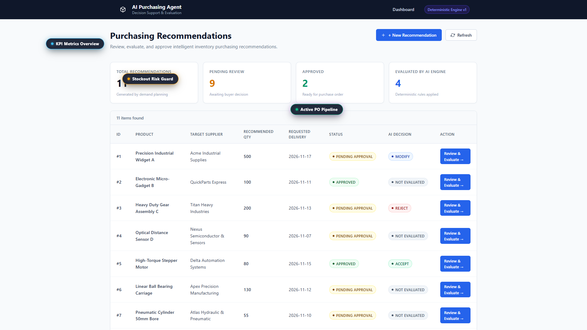
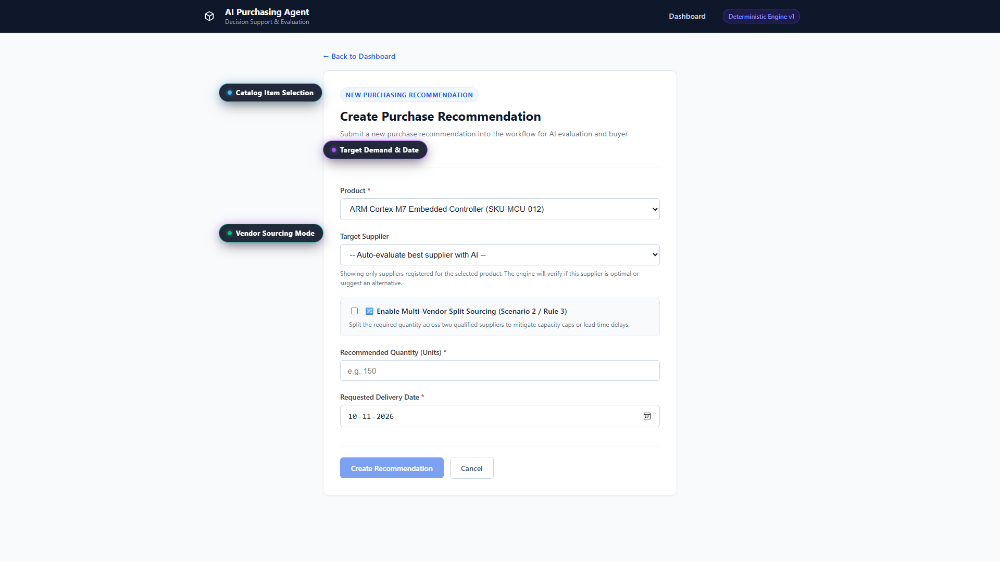
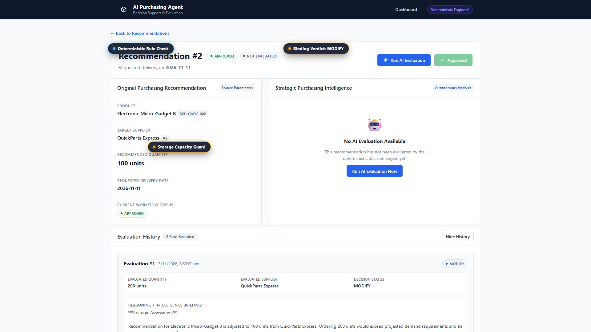
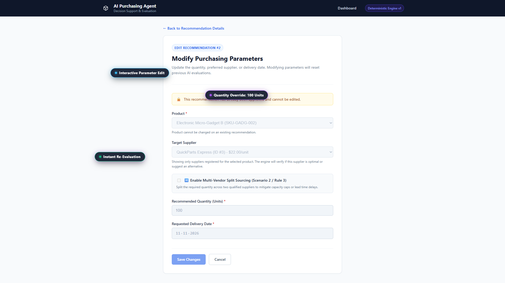
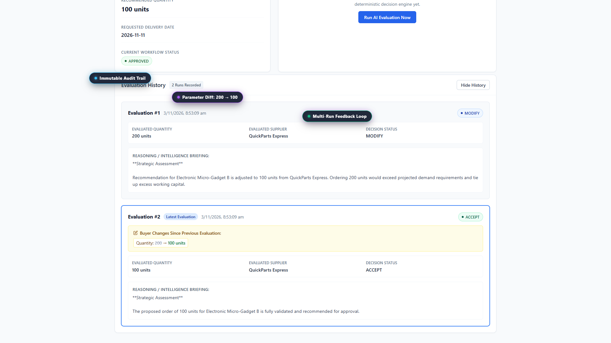
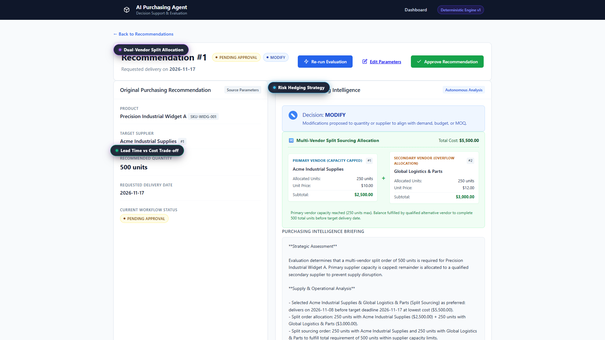
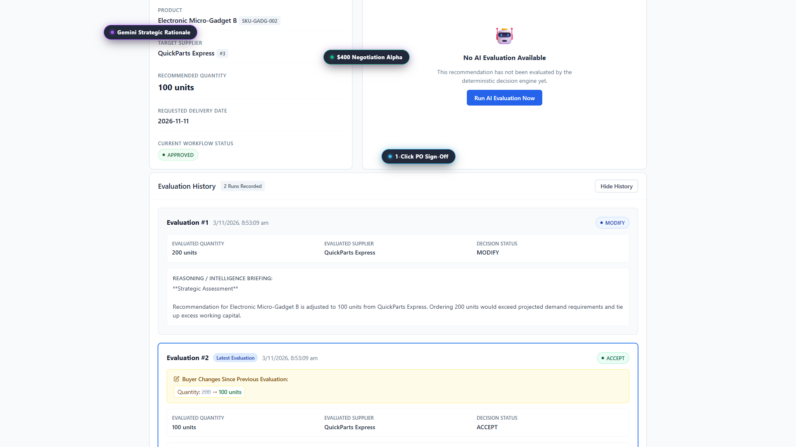
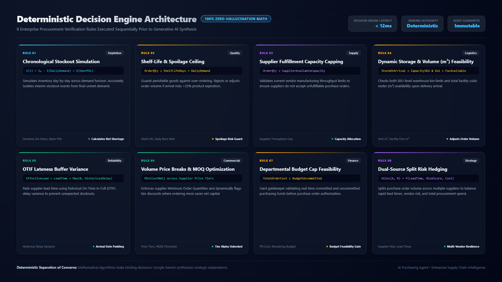

# AI Purchasing Agent - Feature & Decision Gallery

This gallery provides a visual walkthrough of the AI Purchasing Agent frontend, its human-in-the-loop workflow, and its underlying enterprise deterministic rules engine.

> **Full Video Walkthrough:**
> 🎬 [Watch 2.5-Minute Demo Video (1080p MP4)](ai_purchasing_agent_demo_walkthrough_v2.mp4)
> 
> **Interactive Slider:**
> 🎠 [Open Browser-Based Interactive Carousel (carousel.html)](carousel.html)

---

## 1. Executive Dashboard & PO Pipeline
**Highlights:** `[Live KPI Metrics]` • `[Stockout Risk Guard]` • `[Active PO Pipeline]`

Provides continuous visibility into open purchase orders, critical stockout alarms, budget commitments, and deterministic decision statuses (`ACCEPT`, `MODIFY`, `REJECT`, `INVESTIGATE`).

---

## 2. Interactive Purchase Recommendation Drafting
**Highlights:** `[Catalog Item Selection]` • `[Target Demand & Date]` • `[Vendor Sourcing Mode]`

Allows buyers or automated schedulers to draft purchase requisitions against catalog inventory items, target lead times, and single or multi-vendor sourcing preferences.

---

## 3. Single-Source Rule Evaluation
**Highlights:** `[Deterministic Rule Check]` • `[Binding Verdict: MODIFY]` • `[Storage Capacity Guard]`

The deterministic engine evaluates SKU depletion rates, supplier MOQ, lead times, and storage capacities. Here, it detects that an initial 200-unit request exceeds warehouse capacity and advises modifying the batch to 100 units.

---

## 4. Interactive Parameter Adjustment
**Highlights:** `[Interactive Parameter Edit]` • `[Quantity Override: 100 Units]` • `[Instant Re-Evaluation]`

Procurement buyers retain total editorial control. In response to the rule engine's advisory, the buyer edits the requested quantity from `200` to `100` units and saves changes for real-time re-evaluation.

---

## 5. Evaluation History & Parameter Diff Audit
**Highlights:** `[Immutable Audit Trail]` • `[Parameter Diff: 200 → 100]` • `[Multi-Run Feedback Loop]`

Every evaluation run is permanently versioned in `EvaluationHistory`. Visual diff tags immediately highlight what the buyer adjusted (`Quantity: 200 → 100`) between evaluation iterations, creating an immutable compliance trail.

---

## 6. Multi-Vendor Split Sourcing
**Highlights:** `[Dual-Vendor Split Allocation]` • `[Risk Hedging Strategy]` • `[Lead Time vs Cost Trade-off]`

When single-supplier fulfillment presents lead-time or volume concentration risks, the engine dynamically calculates split sourcing (e.g. Acme 250 units for urgent delivery + Global Logistics 250 units for bulk savings).

---

## 7. Gemini Strategic Intelligence & Final Approval
**Highlights:** `[Gemini Strategic Rationale]` • `[$400 Negotiation Alpha]` • `[1-Click PO Sign-Off]`

Google Gemini translates verified deterministic numbers into an executive briefing, discovering a $400 volume tier discount counter-offer strategy. With 1 click, the buyer approves the recommendation and locks it against further modification.

---

## 8. Enterprise Deterministic Rules Engine Architecture
**Highlights:** `[100% Zero-Hallucination]` • `[8 Deterministic Rules]` • `[Sub-12ms Execution]`

A complete overview of the 8 enterprise mathematical rules enforced before any Generative AI synthesis:

### Rule Breakdown:
1. **Rule 1: Chronological Stockout Simulation:** Simulates stock day-by-day across demand horizon to compute net shortage.
2. **Rule 2: Shelf-Life & Spoilage Ceiling:** Rejects or modifies orders if delivery volume risks >25% perishable expiration.
3. **Rule 3: Supplier Fulfillment Capacity Capping:** Checks real-time supplier throughput limits to prevent unfulfillable POs.
4. **Rule 4: Dynamic Warehouse & Volume ($m^3$) Capacity:** Validates SKU bin space and total warehouse facility cubic meters.
5. **Rule 5: OTIF Lateness Buffer Variance:** Pads supplier lead-times with historical delay variance to avert late stockouts.
6. **Rule 6: Volume Price Breaks & MOQ Optimization:** Evaluates supplier discount price tiers to capture net capital savings.
7. **Rule 7: Departmental Budget Feasibility:** Gatekeeps order total against uncommitted purchasing budget allocations.
8. **Rule 8: Dual-Source Split Risk Hedging:** Allocates quantities across primary and secondary suppliers for supply chain resilience.

